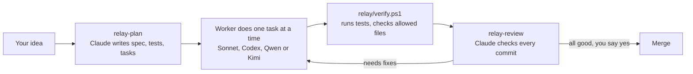

# Claude Code Relay Kit

**Claude Code plans and reviews. A separate worker writes the code.**

A free workflow kit for [Claude Code](https://code.claude.com). Claude turns your idea into a spec and small tasks. A worker (Sonnet, Codex CLI, Qwen Code or Kimi Code) does the tasks. Claude then checks every change before anything is merged.

You don't need to be a developer. You can describe your idea in any language.

[Roman Urdu guide](README-URDU.md)

## How it works



Every batch stays on its own branch (`relay/<batch-name>`), so your main branch stays safe until you approve the merge.

## Install

**You need:** Windows, [Claude Code](https://code.claude.com), [Git](https://git-scm.com) and PowerShell (already on Windows).

1. Download this repo: **Code → Download ZIP**, then extract it. Or clone it:

   ```bash
   git clone https://github.com/theasad13/claude-code-relay-kit.git
   ```

2. Open PowerShell inside the folder and run:

   ```bash
   powershell -NoProfile -ExecutionPolicy Bypass -File .\INSTALL.ps1
   ```

3. Close and reopen Claude Code.

## Use it

Open Claude Code in a project folder and type:

| Step | Type this | What happens |
|---|---|---|
| 1 | `relay-init` | Adds the relay files to your project |
| 2 | `relay-plan <your idea>` | Claude asks a few questions, then creates the spec, tests and tasks |
| 3 | `relay-run` | Sonnet does the tasks, then Claude reviews them |
| 4 | Answer yes or no | Claude merges only after your yes |

Already have a spec? Use `relay-plan SPEC.md`. You can write one with ChatGPT or Gemini using [this prompt](SPEC-PROMPT-ChatGPT-Gemini.md).

## Choose your worker

| Worker | Command | Started by | Usage comes from |
|---|---|---|---|
| Sonnet | `relay-run` | Claude | Your Claude plan |
| Codex CLI | `relay-run codex` | Claude | Your ChatGPT plan |
| Codex CLI, locked down | `relay-run codex strict` | Claude | Your ChatGPT plan |
| Qwen Code or Kimi Code | Open it and type `Do all pending tasks in relay/STATUS.md`, then type `review` in Claude Code | You | That tool's plan |

Codex needs: `npm install -g @openai/codex`, then `codex login`.

## Safety: please read

- **The installer changes your Claude folder.** It adds skills, one agent and the kit to `~/.claude`, adds a Relay section to `~/.claude/CLAUDE.md`, and adds one allow rule to `~/.claude/settings.json`. Replaced files are backed up in `~/.claude/backups/`.
- **That allow rule skips one permission prompt.** Claude can start `codex-worker.ps1` without asking each time. Other commands still follow your normal permissions.
- **Codex auto mode is not a hard wall.** Codex can commit and use the internet. Risky requests go to Codex Auto-review, which is an AI reviewer and can make mistakes. For sensitive projects, use `relay-run codex strict`: no internet, and Claude makes the commits.
- **Tests run on your machine.** `verify.ps1` runs each task's test command, so only use it on projects you trust.
- **`verify.ps1` needs `expect_output`.** Without that line in a task, a run where no test executed can still show PASS. `relay-plan` always adds it.
- **Check your own plans.** Automatic use counts against your Claude and ChatGPT usage. The kit never starts Qwen or Kimi for you.

This software comes with no warranty. Review what it does before you rely on it.

## What's inside

```
INSTALL.ps1                      Installer
claude/agents/relay-worker.md    Sonnet worker
claude/skills/                   relay-init, relay-plan, relay-run, relay-review
claude/relay-kit/
  relay-init.ps1                 Copies the kit into a project
  codex-worker.ps1               Runs one task with Codex
  templates/project/relay/       WORKER.md, STATUS.md, verify.ps1, task and report templates
```

## Good to know

- Tested on Windows 11 with PowerShell 5.1 and Codex CLI 0.165. Mac and Linux are not supported yet.
- To undo the install, restore your files from `~/.claude/backups/` and delete the `relay-*` skills, `~/.claude/relay-kit` and `~/.claude/agents/relay-worker.md`. Also remove the allow rule from `settings.json`.

## License

[MIT](LICENSE). Free to use, change and share.

This is a community project. It is not made by or affiliated with Anthropic, OpenAI, Alibaba or Moonshot AI.
